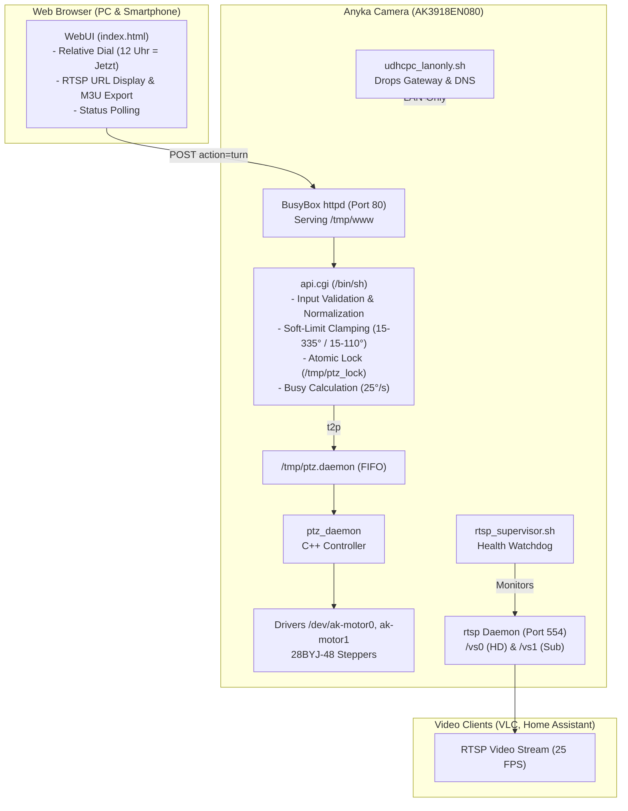

# Anyka Domecam WebUI

[](LICENSE)
[](https://github.com)
[](https://github.com)
[](https://github.com)

A lightweight, robust, and secure WebUI with **purely relative PTZ control** and native **RTSP streaming** for Anyka-based dome IP cameras (AK3918EN080 / V380 / generic PTZ cameras).

---

## 🎯 Problems Solved

Stock firmware and existing web overlays for Anyka dome cameras suffer from several critical shortcomings:
1. **Broken Absolute Positioning:** The internal stepper motors (28BYJ-48) lack hardware feedback/hall pins. Mechanical collisions or cold boots leave the software coordinate system completely unreferenced, leading to gear grinding and unpredictable jumps.
2. **Resource-Exhausting Snapshot Loops:** Repeatedly polling `snap.jpg` via HTTP creates high CPU load and memory leaks on the constrained 64 MB RAM SoC (often leaving only 10–14 MB free), frequently crashing the camera.
3. **Cloud Leaks & Telemetry:** Factory daemons attempt to phone home to cloud services or establish P2P tunnels over the internet.
4. **Race Conditions & Queue Grinding:** Rapidly clicking directional buttons floods the motor FIFO, locking up the camera while motors grind against stops.

**This project completely eliminates these issues.**

---

## ✨ Key Features

- **Purely Relative PTZ Dial:** 
  - Visual circular dial (12 o'clock = "current view").
  - Drag or tap to turn by any relative angle from $-180^\circ$ to $+180^\circ$ (left/right) and $-60^\circ$ to $+60^\circ$ (up/down).
  - Quick-action preset buttons ($15^\circ, 45^\circ, 90^\circ, 180^\circ$).
  - Full touch and mouse support with `touch-action: none` and `pointercancel` protection.
- **Native RTSP Integration:**
  - Zero snapshot polling! All video is handled via hardware-accelerated RTSP (Port 554) @ 25 FPS.
  - Dual stream URLs for Main (`/vs0` 1080p) and Sub (`/vs1` 480p).
  - Instant one-click copy and auto-generated VLC `.m3u` playlist download.
- **Strict LAN-Only Isolation:**
  - Custom DHCP hook (`udhcpc_lanonly.sh`) automatically strips default gateways and blanks DNS servers.
  - Zero cloud leakage: the camera stays strictly confined to the local network.
- **Atomic Busy Locking:**
  - Atomic `mkdir`-based locks enforce physical transit times based on measured motor speed ($25^\circ/\text{s}$).
  - All overlapping movement requests are rejected cleanly with `{"ok":false,"err":"busy"}` instead of queueing up.
- **Hardware Soft-Limits & Octal-Safe Normalization:**
  - Clamping to safe physical limits ($15^\circ..335^\circ$ Pan, $15^\circ..110^\circ$ Tilt).
  - Normalization of leading zeros (e.g. `dpan=-015` $\rightarrow$ `-15`) prevents BusyBox `ash` octal parsing traps.
- **Ultra-Lightweight Footprint:**
  - Written in pure POSIX `/bin/sh` and standard HTML5/CSS/JavaScript without frameworks.
  - Consumes $< 500\,\text{KB}$ RAM in tmpfs; executes in $< 30\,\text{ms}$.

---

## 🏛️ Architecture & How It Works



### The Relative PTZ Mechanics
1. On boot, `ptz_daemon` initializes `cur_pos = 0` regardless of the camera's actual physical orientation.
2. In this architecture, coordinates in `ptz.ini` serve only as internal software offsets bounded by soft-limits ($15^\circ..335^\circ$ Pan, $15^\circ..110^\circ$ Tilt).
3. When the user requests a turn of $\Delta\text{pan} = +45^\circ$, `api.cgi`:
   - Reads current software position `CUR_PAN`.
   - Adds $\Delta\text{pan}$ and clamps to $[15, 335]$.
   - Calculates duration: $T_{\text{busy}} = 1000\,\text{ms} + \frac{|\Delta\text{pan}| \times 1000}{25}$.
   - Sets an atomic lock in `/tmp/ptz_busy_until`.
   - Sends `t2p <final_pan> <final_tilt>` to `/tmp/ptz.daemon`.
   - Returns JSON with `requested`, `executed`, `clamped`, and `busy_ms`.
4. The WebUI locks all controls for $T_{\text{busy}}$ seconds, displays countdown feedback, and resets the visual dial back to $0^\circ$ ("Now").

---

## 📁 Repository Structure

```text
├── webui/
│   └── www/
│       ├── index.html              # Responsive WebUI (HTML5/CSS3/Vanilla JS)
│       └── cgi-bin/
│           └── api.cgi             # Hardened POSIX CGI handler
├── start_webui.sh                  # SD card master boot script
├── rtsp_supervisor.sh              # RTSP daemon watchdog & health restarter
├── bin/
│   └── udhcpc_lanonly.sh           # LAN-isolation DHCP hook
├── tools/
│   └── cam_ctl.py                  # Standalone Python CLI for camera control & file sync
├── anyka_architecture_spec.md      # Detailed hardware & engineering specification
├── LICENSE                         # MIT License
└── README.md
```

---

## 🚀 Installation & Setup

### Prerequisites
1. An Anyka AK3918-based dome camera (AK3918EN080 or compatible).
2. MicroSD card (FAT32 formatted) with the Anyka SD card exploit/bootloader enabled.
3. Python 3 on your workstation (for `cam_ctl.py`).

### Step 1: Copy Files to MicroSD Card
Place the files into `/mnt/anyka_webui/` on your MicroSD card:
```text
/mnt/anyka_webui/
├── start_webui.sh
├── rtsp_supervisor.sh
├── bin/
│   └── udhcpc_lanonly.sh
└── www/
    ├── index.html
    └── cgi-bin/
        └── api.cgi
```

Make sure script permissions are executable:
```bash
chmod 755 start_webui.sh rtsp_supervisor.sh bin/udhcpc_lanonly.sh www/cgi-bin/api.cgi
chmod 644 www/index.html
```

### Step 2: Over-The-Air Deployment via `cam_ctl.py`
If your camera is already running on the local network (default Telnet port 23):
```bash
# Upload WebUI and CGI backend
./tools/cam_ctl.py --host <CAMERA_IP> put webui/www/cgi-bin/api.cgi /mnt/anyka_webui/www/cgi-bin/api.cgi
./tools/cam_ctl.py --host <CAMERA_IP> put webui/www/index.html /mnt/anyka_webui/www/index.html

# Set permissions and mirror to live web root
./tools/cam_ctl.py --host <CAMERA_IP> exec "chmod 755 /mnt/anyka_webui/www/cgi-bin/api.cgi && chmod 644 /mnt/anyka_webui/www/index.html && cp -f /mnt/anyka_webui/www/index.html /tmp/www/index.html && cp -f /mnt/anyka_webui/www/cgi-bin/api.cgi /tmp/www/cgi-bin/api.cgi"
```

### Step 3: Access the WebUI
Open your browser and navigate to:
```text
http://<CAMERA_IP>/
```

---

## 📡 API Reference

All mutating actions require `POST` and pass parameters in the URL query string or body.

### 1. System Status
`GET /cgi-bin/api.cgi?action=status`

**Response:**
```json
{
  "ok": true,
  "uptime_s": 3413,
  "avail_kb": 24672,
  "lan_isolated": true,
  "wifi_link": "83",
  "wifi_dbm": "54",
  "ptz_ready": 1,
  "rtsp_ready": 1,
  "busy": false,
  "busy_remaining_s": 0,
  "ptz_valid": true,
  "debug_pan": 270,
  "debug_tilt": 25
}
```

### 2. Relative Turn (`turn`)
`POST /cgi-bin/api.cgi?action=turn&dpan=<int>&dtilt=<int>[&dry=1]`

| Parameter | Type | Range | Description |
| :--- | :--- | :--- | :--- |
| `dpan` | Integer | $-180 \dots +180$ | Relative Pan delta ($>0$: right, $<0$: left). Max 4 chars. |
| `dtilt` | Integer | $-60 \dots +60$ | Relative Tilt delta ($>0$: down, $<0$: up). Max 4 chars. |
| `dry` | Integer | `0` or `1` | Optional dry-run flag. Calculates without moving motors. |

**Success Response:**
```json
{
  "ok": true,
  "requested": { "dpan": 45, "dtilt": -15 },
  "executed": { "dpan": 45, "dtilt": -15 },
  "clamped": false,
  "busy_ms": 2800
}
```

**Clamped Response (Hit Soft-Limit):**
```json
{
  "ok": true,
  "requested": { "dpan": 90, "dtilt": 0 },
  "executed": { "dpan": 65, "dtilt": 0 },
  "clamped": true,
  "busy_ms": 3600
}
```

**Busy Rejection:**
```json
{
  "ok": false,
  "err": "busy",
  "busy_remaining_s": 3
}
```

### 3. LED Control
- Turn on: `POST /cgi-bin/api.cgi?action=light_on`
- Turn off: `POST /cgi-bin/api.cgi?action=light_off`

### 4. Direct Micro-Stepping
- Step Up: `POST /cgi-bin/api.cgi?action=up[&step=1..5]`
- Step Down: `POST /cgi-bin/api.cgi?action=down[&step=1..5]`
- Step Left: `POST /cgi-bin/api.cgi?action=left[&step=1..5]`
- Step Right: `POST /cgi-bin/api.cgi?action=right[&step=1..5]`
- Stop: `POST /cgi-bin/api.cgi?action=stop`

---

## 🛠️ Management CLI (`tools/cam_ctl.py`)

The repository includes a dependency-free Python tool for interacting with the camera via Telnet and FTP:

```bash
# Execute command on camera
./tools/cam_ctl.py --host <CAMERA_IP> exec "uptime"

# Upload file via FTP
./tools/cam_ctl.py --host <CAMERA_IP> put local_file.sh /mnt/anyka_webui/remote_file.sh

# Download file
./tools/cam_ctl.py --host <CAMERA_IP> get /mnt/anyka_webui/boot.log ./boot.log
```

---

## 🔒 Security & LAN Isolation

To ensure that the camera does not send private video feeds to overseas cloud servers:
1. `bin/udhcpc_lanonly.sh` intercepts DHCP leases.
2. It sets the local IP and netmask on `wlan0`.
3. It explicitly deletes the default gateway (`route del default`).
4. It sets `/etc/resolv.conf` to empty (`# LAN-only, no DNS`).
5. As a result, the camera can only be reached from within your local subnet or VPN; WAN connections are physically unroutable.

---

## 📄 License

This project is open-source software licensed under the [MIT License](LICENSE).
